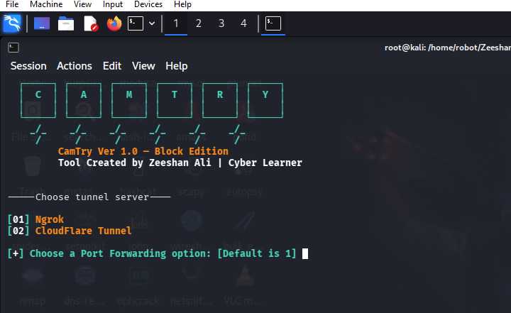

# Camtry
Grab cam shots from target's phone front camera or PC webcam just sending a link.
<p align="center">

</p>

## What is Camtry
<p>Camtry is techniques to take cam shots of target's phone front camera or PC webcam. CamPhish Hosts a fake website on in built PHP server and uses ngrok & CloudFlare Tunnel to generate a link which we will forward to the target, which can be used on over internet. website asks for camera permission and if the target allows it, this tool grab camshots of target's device

TOOL Created by Zeeshan Ali 

A GPS location capture feature has been added.</p>

## Features
<p>In this tool I added two automatic webpage templates for engaged target on webpage to get more picture of cam</p>
<ul>
  <li>Festival Wishing</li>
  <li>Live YouTube TV</li>
  <li>Online Meeting [Beta]</li>
  <li>GPS Location Tracking</li>
</ul>
<p>A cleanup script has been added to remove all unnecessary files and logs.</p>

### This Tool Tested On :
<ul>
  <li>Kali Linux</li>
  <li>Termux</li>
  <li>MacOS</li>
  <li>Ubuntu</li>
  <li>Parrot Sec OS</li>
  <li>Windows (WSL)</li>
</ul>

### Installing and requirements
  This tool require PHP for webserver, and wget for downloading dependencies. First run following command on your terminal

### For Linux
```$apt update && apt upgrade -y  ```<br>
```$ apt-get -y install php wget unzip && apt-get -y install bash```<br>
### For Termux

```$ pkg update && pkg upgrade -y ```<br>
```$ pkg-get -y install php wget unzip && pkg-get -y install bash ```<br>

### Installing (Kali Linux/Termux):

```$ git clone https://github.com/Zeeshan-78/Camtry.git ```<br>
```$ cd Camtry ```<br>
```$ chmod +x camtry.sh ```<br>
```$ bash camtry.sh ```<br>


### Clean logs & unnecessary files :

```$ bash cleanup.sh ```<br> 
<p>The cam files and saved location will also be removed.</p>

### Added Log:

 Added GPS Location Tracking
<ul>
  <li> GPS location capturing functionality</li>
  <li> Google Maps integration for captured locations</li>
  <li> Location accuracy reporting</li>
  <li> Improved loading screen with location request</li>
</ul>

#### Enhanced architecture detection
<ul>
  <li> Improved architecture detection for all CPU types</li>
  <li> Better support for Apple Silicon (M1/M2/M3) Macs</li>
  <li> Automatic detection of ARM, ARM64, x86, and x86_64 architectures</li>
  <li> Windows compatibility improvements</li>
  <li> CloudFlare Tunnel download issues</li>
</ul>

#### Support
<ul>
  <li>Add support for Apple sillicon (M1/M2/M3 ARM64)</li>
  <li>Add support for arm64 like Raspberry Pi</li>
</ul>

#### Important Notice

Unauthorized reuploading of this project is prohibited.

CamPhish is created to help in penetration testing and it's not responsible for any misuse or illegal purposes.
CamPhish is inspired by https://github.com/techchipnet/Camphish.git Big thanks to @thelinuxchoice
